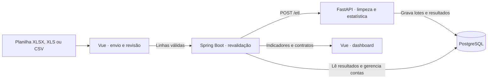

# CTI Insights · CTI SENAI

Projeto integrador do SENAI para importar planilhas comerciais da Provedor CTI, revisar os registros e acompanhar indicadores da carteira por lote.

## Fluxo de dados



1. Em **Enviar planilha**, o navegador lê o arquivo e abre a **Revisão** com os erros por linha.
2. Ao confirmar o envio, o Spring revalida os registros e encaminha as linhas aprovadas ao Python.
3. O Python padroniza os registros, calcula as estatísticas e salva o lote no PostgreSQL. O dashboard permite selecionar o lote e consultar os contratos.

O cadastro cria uma conta pendente. Um administrador libera o acesso na tela **Usuários**.

## Estrutura

| Pasta | Conteúdo |
| --- | --- |
| [FrontEnd](FrontEnd/README.md) | Vue, Pinia, Vue Router, Tailwind e Chart.js |
| [BackEnd](BackEnd/README.md) | API Spring Boot, JWT, validação e consulta de lotes |
| [analytics-python](analytics-python/README.md) | ETL FastAPI, pandas, SciPy e SQLAlchemy |
| [database](database/README.md) | Estrutura PostgreSQL e consultas |
| [docs](docs/CONTRATO.md) | Contratos de integração e instruções de teste |
| [Data](Data) e [sample-data](sample-data) | Bases e planilhas de teste do projeto |
| [testes](docs/TESTES.md) | Verificação integrada dos serviços |

## Executar localmente

Use Java 21, Maven 3.9+, Node.js 20.19+ da série 20 ou Node.js 22.12+, e Python 3.10+.

Crie um `.env` em cada serviço com base no respectivo `.env.example`. Configure Java e Python para o mesmo banco PostgreSQL e preencha `ETL_API_KEY` com o mesmo valor nos dois serviços. Veja os detalhes em [BackEnd](BackEnd/README.md) e [analytics-python](analytics-python/README.md).

Em terminais separados, a partir da raiz:

```powershell
# Terminal 1: Java, porta 8080
cd BackEnd
mvn spring-boot:run
```

```powershell
# Terminal 2: Python, porta 8000
cd analytics-python
python -m venv .venv
.\.venv\Scripts\python.exe -m pip install -r requirements.txt
.\.venv\Scripts\python.exe -m uvicorn api:app --port 8000
```

```powershell
# Terminal 3: Vue, porta 5173
cd FrontEnd
npm ci
npm run dev
```

Abra http://localhost:5173. Use `sample-data/dados.xlsx` para testar o fluxo de ponta a ponta. A base de 300 registros em `Data/` serve para comparar a validação do navegador com o gabarito.

Consulte os [testes e resultados esperados](docs/TESTES.md) e o [contrato entre os serviços](docs/CONTRATO.md).

Estrutura baseada no [projeto de referência da professora](https://github.com/tatianaifsp/cti-projeto).
