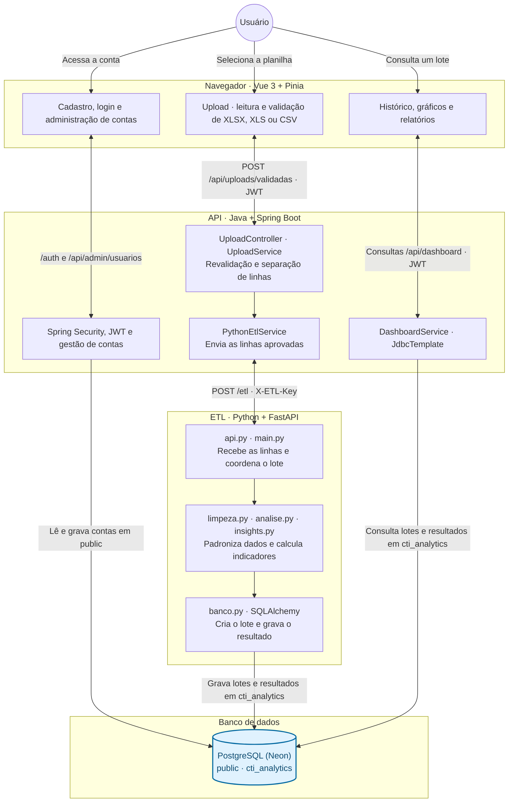
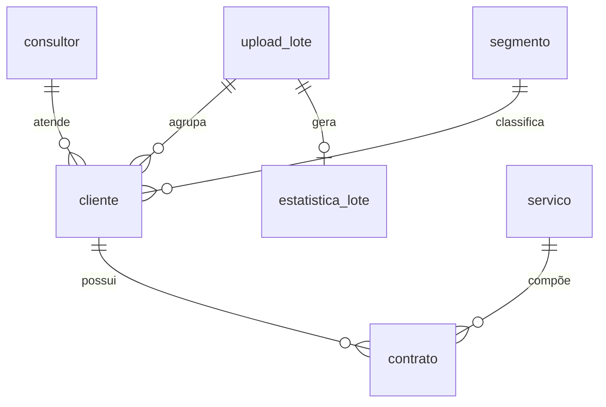

# CTI Insights · CTI SENAI

Projeto integrador do SENAI para importar planilhas da carteira de clientes da Provedor CTI, validar dados e consultar indicadores por lote.

## Arquitetura e fluxo de dados

O diagrama descreve a implementação da branch `ajuste-fluxo-python-professora`, com base no [fluxo publicado pela professora](https://github.com/tatianaifsp/cti-projeto/blob/main/README.md#fluxo-de-dados).

1. O Vue lê a planilha no navegador e mostra a prévia com as linhas válidas e os erros. Ao confirmar, envia ao Spring as linhas aprovadas e a contagem das descartadas.
2. O Spring revalida os dados e envia somente as linhas aprovadas ao `POST /etl`. Com zero linhas válidas, o Spring devolve HTTP 400.
3. O Python padroniza os dados, calcula estatísticas e insights e cria o lote como `PROCESSANDO`. Ao gravar os resultados em uma transação, marca o lote como `PROCESSADO`. Se a gravação falhar, desfaz as inserções da transação e tenta registrar `ERRO` no lote.
4. Após a confirmação do Python, o Spring responde ao Vue com HTTP 201 e `loteId`. As telas de gráficos e relatórios usam `/api/dashboard`, `/api/dashboard/lotes` e `/api/dashboard/lotes/{id}/clientes` para consultar os dados salvos.

## Modelo de dados da importação

O PostgreSQL no Neon reúne os dois esquemas. `cti_analytics` guarda os dados importados e suas estatísticas. `public` reúne as contas em `usuarios` e as tabelas acessadas pelos CRUDs Java.

Cada cliente importado pode gerar um contrato por serviço distinto. `estatistica_lote` armazena o resultado usado nos gráficos, incluindo indicadores e insights.

## Executar o projeto

- [Integração e execução local](INTEGRACAO_CTI.md)
- [Implantação com Docker Compose](DEPLOY.md). O Nginx serve o Vue e encaminha `/api/` e `/auth/` ao Spring. A chamada do Spring ao Python passa pela rede interna dos containers.
- [Código e instruções do frontend](FrontEnd/README.md), [backend](BackEnd/README.md) e [ETL Python](analytics-python/README.md)
