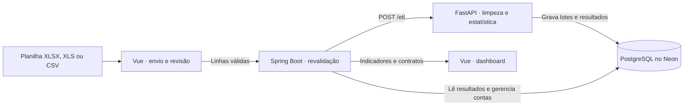

# CTI Insights · CTI SENAI

Projeto integrador do SENAI para importar planilhas comerciais da Provedor CTI, revisar os registros e acompanhar indicadores da carteira por lote.

## Diagrama de arquitetura

O diagrama mostra as telas Vue, os endpoints Spring, o ETL Python e as conexões com o PostgreSQL no Neon. [Ver diagrama em PNG](docs/diagrama-cti-neon.png) · [Abrir arquivo editável no draw.io](docs/diagrama-cti-neon.drawio)

## Fluxo de dados



1. Em **Enviar planilha**, o navegador lê o arquivo e abre a **Revisão** com os erros por linha.
2. Ao confirmar o envio, o Spring revalida os registros e encaminha as linhas aprovadas ao Python.
3. O Python padroniza os registros, calcula as estatísticas e salva o lote no PostgreSQL. O dashboard permite selecionar o lote e consultar os contratos.

O cadastro cria uma conta pendente. Um administrador libera o acesso na tela **Usuários**.

## Estrutura

| Pasta | Conteúdo |
| --- | --- |
| [FrontEnd](FrontEnd/README.md) | Vue, Pinia, Vue Router, Tailwind e Chart.js |
| [BackEnd](BackEnd/README.md) | API Spring Boot, JWT, validação e consulta de lotes |
| [analytics-python](analytics-python/README.md) | ETL FastAPI, pandas, SciPy e SQLAlchemy |
| [database](database/README.md) | Estrutura PostgreSQL e consultas |
| [docs](docs/CONTRATO.md) | Contratos de integração e instruções de teste |
| [Data](Data) e [sample-data](sample-data) | Bases e planilhas de teste do projeto |
| [testes](docs/TESTES.md) | Verificação integrada dos serviços |

## Executar localmente

Use Java 21, Maven 3.9+, Node.js 20.19+ da série 20 ou Node.js 22.12+, e Python 3.10+.

Crie um `.env` em cada serviço com base no respectivo `.env.example`. Configure Java e Python para o mesmo banco PostgreSQL e preencha `ETL_API_KEY` com o mesmo valor nos dois serviços. Veja os detalhes em [BackEnd](BackEnd/README.md) e [analytics-python](analytics-python/README.md).

Em terminais separados, a partir da raiz:

```powershell
# Terminal 1: Java, porta 8080
npm run dev:api
```

```powershell
# Terminal 2: Python, porta 8000
cd analytics-python
python -m venv .venv
.\.venv\Scripts\python.exe -m pip install -r requirements.txt
cd ..
npm run dev:etl
```

```powershell
# Terminal 3: Vue, porta 5173
npm --prefix FrontEnd ci
npm run dev
```

As tarefas **CTI · Iniciar Spring Boot** e **CTI · Iniciar FastAPI** do VS Code usam os mesmos comandos. Na configuração local com Neon, eles conectam por WebSocket seguro na porta 443. Para usar a conexão PostgreSQL direta, defina `CTI_DB_TRANSPORT=direct` no `.env` do serviço. Execute `npm run check:etl` na raiz para verificar o banco do ETL.

Abra http://localhost:5173. Use `sample-data/dados.xlsx` para testar o fluxo de ponta a ponta. A base de 300 registros em `Data/` serve para comparar a validação do navegador com o gabarito.

Consulte os [testes e resultados esperados](docs/TESTES.md) e o [contrato entre os serviços](docs/CONTRATO.md).

## Publicar na Vercel e no Render

1. Escolha o banco do Neon para a publicação. Se precisar preservar contas e importações existentes, copie os dados para o destino e confira as contagens antes de trocar as conexões.
2. Importe o repositório na Vercel e escolha `FrontEnd` como **Root Directory**. Anote o domínio de produção atribuído ao projeto.
3. No Render, use o Blueprint [render.yaml](render.yaml). Aponte ambos os serviços para o mesmo banco e branch do Neon. No Spring, informe `DB_URL` no formato `jdbc:postgresql://HOST:5432/BANCO?sslmode=require&channelBinding=require`, `DB_USER` e `DB_PASSWORD`. No FastAPI, informe `DB_HOST`, `DB_NAME`, `DB_USER` e `DB_PASSWORD`. Configure `CORS_ALLOWED_ORIGINS` com a origem HTTPS da Vercel, sem barra final.
4. Na Vercel, defina `VITE_API_URL` com a URL HTTPS do Spring e `VITE_API_TIMEOUT_MS=150000` para acomodar a inicialização dos serviços gratuitos. Publique o frontend após salvar as variáveis de produção.
5. Confira `/api/health` no Spring, `/saude` no FastAPI e `/login` na Vercel. Entre com uma conta existente e confira o histórico de lotes do dashboard.

Estrutura baseada no [projeto de referência da professora](https://github.com/tatianaifsp/cti-projeto).
